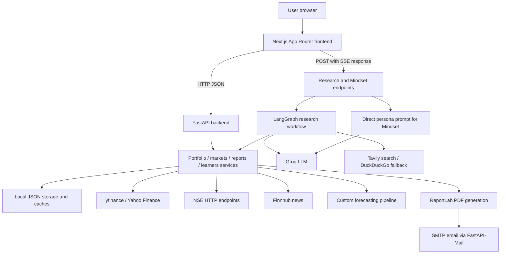

> Research Lab increment 5: current graph, report/review APIs, additive schema, validation results, live limitations and PS1 requirement matrix are documented in [RESEARCH_LAB.md](RESEARCH_LAB.md). Existing historical descriptions below may refer to earlier increments.

# Veritas — Complete Project and Feature Documentation

> **Research Lab update:** Increment 1 adds durable cases and document intake; increment 2 adds source-linked facts, analyst review and deterministic calculations; increment 3 adds a separate bounded Dexter analyst workflow and Analysis tab; increment 4 adds scoped claim verification, an Evidence tab, shared research model settings and honest partial briefs. See [RESEARCH_LAB.md](RESEARCH_LAB.md) for architecture, APIs, limits, actual live-provider results and exact manual checks. The original analysis below describes the application before these increments.

**Analysis date:** 24 October 2026  
**Scope:** The frontend and backend source code in this repository.  
**Method:** Static inspection of routes, components, API clients, backend endpoints, services, agent workflows, model training code, dependency manifests, and bundled datasets. Runtime behavior requiring external providers or credentials was not independently tested. Implementation statements below describe the checked-in code, not a guarantee that every integration is currently reachable.

## Contents

1. [What the project is](#1-what-the-project-is)
2. [Who it serves and what it does for them](#2-who-it-serves-and-what-it-does-for-them)
3. [Application map](#3-application-map)
4. [Detailed user features](#4-detailed-user-features)
5. [Practical user journeys](#5-practical-user-journeys)
6. [Actual feature readiness](#6-actual-feature-readiness)
7. [Technical architecture](#7-technical-architecture)
8. [Tech stack](#8-tech-stack)
9. [AI research architecture](#9-ai-research-architecture)
10. [Forecasting models](#10-forecasting-models)
11. [Data, calculations, and persistence](#11-data-calculations-and-persistence)
12. [Backend API inventory](#12-backend-api-inventory)
13. [Local setup and configuration](#13-local-setup-and-configuration)
14. [Limitations and implementation issues](#14-limitations-and-implementation-issues)
15. [Source guide](#15-source-guide)

## 1. What the project is

Veritas is a browser-based investment research, portfolio tracking, and financial learning application. It brings together a dashboard, investment records, market exploration, an AI research assistant, investor-style mentoring, portfolio strategy tools, forecasts, and reporting.

Its central idea is to let an individual investor move between three activities in one place:

- **Understand investments:** inspect holdings, prices, allocation, gains and losses, and market news.
- **Research decisions:** ask questions, verify financial claims, analyze an asset, explore hypothetical events, and draft strategies with supporting sources.
- **Improve investing knowledge:** study curated resources and explore the mental models of well-known investors.

The code is best understood as a substantial hackathon/demo prototype. Several backend capabilities perform real calculations or call external services, while some visible frontend sections remain illustrative. It does not contain a brokerage integration or place exchange orders. “Buy,” “Sell,” and rebalancing actions operate on local application records.

The product is branded **Veritas** in the interface. The backend still uses the legacy title **CodeCrafters API**, and package names are generic (`backend`, `my-app`). These refer to the same project.

## 2. Who it serves and what it does for them

The intended audience, inferred from the features, is individual investors, people learning to invest, and users who want an AI-assisted research workspace. The application mixes Indian-market concepts such as NSE tickers, rupee formatting, financial years, and SEBI checks with US equities, global indices, options, and cryptocurrency data.

| User need | What Veritas provides | Practical result |
|---|---|---|
| “What do I own and how is it doing?” | Holdings, valuation, P&L, allocation, and activity views | A consolidated investment overview |
| “What is happening in the market?” | News, stock search, price histories, charts, and market panels | Context for further research |
| “Is this financial claim credible?” | News verification with web/news context and source cards | An AI-generated assessment that can be examined against sources |
| “Help me think through an investment” | Asset analysis, strategy advice, and what-if questions | A structured research response |
| “How should I organize my portfolio?” | Diversification scoring, allocation comparisons, rebalancing suggestions, strategy drafts, and goals | A planning workspace |
| “How might a stock trend?” | Trainable trend models and forecast comparisons | Model-based projections and evaluation metadata |
| “How can I learn?” | Videos, books, interviews, quizzes, XP, and investor personas | A guided learning experience |
| “Can I keep a report?” | Backend-generated PDF download and configured email delivery | A portable report derived from stored records |

There is no implemented account onboarding, authentication, or per-user portfolio isolation in the inspected API. User labels and session IDs should not be interpreted as an account system.

## 3. Application map

| URL | Screen | Main purpose |
|---|---|---|
| `/` | Landing page | Introduce the product with animated marketing sections |
| `/overview` | Overview | Portfolio snapshot, allocation, top holdings, activity, and news |
| `/investment` | Investments | Holdings, watchlist, portfolio chart, opportunities, and forecasting |
| `/market` | Markets | Market cards, candlestick chart, sector heatmap, signals, and asset explorer |
| `/insights` | Insights | Main Veritas AI research chat and evidence workspace |
| `/mindset` | Mindset | Chat guided by a selected investor's documented mental model |
| `/portfolio` | Portfolio | Diversification, allocation, rebalancing, strategy editor, and goals |
| `/reports` | Reports | Reporting interface, transaction history, PDF download, and email |

The shared sidebar links to all eight application screens and can collapse. Its collapsed state is saved in browser `localStorage`. Shared navigation and stock-search components support movement between research views.

## 4. Detailed user features

### 4.1 Landing page

The root page is a visual product introduction composed from navigation, hero, ticker tape, statistics, feature, orbit, demo, and footer components. GSAP and Three.js are included for the visual experience. The landing page explains and showcases the application; displayed promotional statistics do not establish measured operational performance.

### 4.2 Overview: a quick investment snapshot

Users can open **Overview** to see:

- Portfolio value, total return, a cash-flow-labelled metric, dividends, and a risk label.
- An asset allocation visualization.
- Top holdings ranked using daily changes.
- Recent activity such as recorded purchases, sales, or dividends.
- Financial news with source links, categories, sentiment labels, and publication timestamps.

The data loader calls portfolio summary, top performers, activity, insights, and risk-score endpoints. News is fetched separately so a news failure need not discard the other results.

**Important behavior:** the loader falls back to sample data when requests fail, and empty news/activity can also result in sample content. The decorative portfolio chart is static. The displayed “quarterly” change is mapped from total P&L percentage rather than a quarter-specific return calculation. The cash-flow-labelled field is mapped from total P&L. The overview risk score comes from a mock backend service with randomized ranges; it is separate from the computed diversification score on Portfolio.

### 4.3 Investments: holdings and watchlist management

The Investments screen displays total investment value, all-time profit, daily change, buying power, a performance chart, asset breakdown, active holdings, a watchlist, opportunities, and a risk alert.

**Adding a holding**

1. Open the buy/add asset modal from Active Holdings.
2. Search for and choose a ticker.
3. Supply quantity, average purchase price, and purchase date.
4. Submit the form.

The backend adds the position or increases an existing position using a weighted average purchase price, and appends a buy transaction. The page reloads after success. This records an investment in the local portfolio; it does not purchase securities through a broker.

**Removing a holding**

The Sell modal calls the holding-removal endpoint. Its actual behavior is to remove the entire symbol from active holdings. That path does not record a corresponding sell transaction or proceeds and does not implement partial sales. The distinction matters because closed-position reports depend on transaction history.

**Inspecting holdings**

Rows show shares, cost basis, current price, market value, percentage return, and trend sparklines. Selecting a holding opens its detail modal. Quotes and histories are obtained through backend market-data services where connected.

**Watchlist**

Users can search for a stock and add a watchlist entry with optional tracking details such as quantity and dates. The table requests the unified investments payload. Backend removal support also exists. Watchlist entries are tracking records and do not constitute holdings or orders.

**Performance and opportunities**

The chart offers `1M`, `3M`, `1Y`, and `ALL` views. However, the current investment loader deliberately generates mock performance history even when portfolio statistics load successfully. Its curve is not an audited historical return series. Opportunity cards come from a mock backend service. Some alert/asset-breakdown values also use defaults or simplifying assumptions.

### 4.4 Future predictions

The forecasting section lets users select an asset and compare model outputs in a modal. It supports these backend model identifiers:

- `hybrid`
- `linear`
- `logistic`
- `linear_stochastic`
- `regime_switch`

Users can train/retrain from the interface. Requests include ticker, model selection, historical period, and forecast horizon. The API accepts horizons from **7 to 90 business days** and periods including `1mo`, `3mo`, `6mo`, `1y`, `2y`, `5y`, `10y`, `ytd`, and `max`. A syntactically accepted short period can still provide too few observations for training.

The backend returns chart-ready forecasts and training metadata, with cached JSON output available for several bundled tickers. These are statistical experiments based on historical prices; the repository does not establish reliable future trading performance. The technical model details appear in section 10.

### 4.5 Markets: search and chart exploration

The Markets screen contains:

- S&P 500, NASDAQ, Bitcoin, and Ethereum cards.
- A candlestick chart with `1D`, `1W`, `1M`, and `1Y` periods.
- Hover details for individual candles and volume.
- An RSI-labelled oscillator.
- Sector heatmap and expanded heatmap modal.
- Algorithmic signal cards and sector growth forecasts.
- An asset explorer with Stocks, Options, and Crypto tabs.

The initial loader fetches NASDAQ history for the four periods but spreads the rest of the market payload from `mockMarketData`. Consequently, initial index cards, sectors, signals, growth forecasts, and explorer rows are illustrative even though backend endpoints exist to compute equivalent categories.

The page accepts a `stock` URL query parameter, for example `/market?stock=AAPL`. This fetches the selected ticker's quote and histories and replaces the chart. Search/detail components elsewhere also fetch stock information and price history.

**Technical indicators:** the main chart explicitly describes its oscillator as a mock oscillator based on close momentum. A searched stock receives placeholder RSI and volatility values. These should not be treated as validated technical measurements.

The separate `/yf/analyze-chart` backend endpoint calculates trend, support/resistance, volatility, signals, and a BUY/HOLD/SELL narrative from submitted OHLCV bars and optional RSI/MACD. Despite its “AI-powered” description, this service uses deterministic rules and templates rather than an LLM call.

### 4.6 Insights: AI financial research

Insights is the main AI workspace. Users enter a question or choose one of five quick actions. A sixth general-research path handles questions outside those specialized modes.

| Mode | How the user uses it | Backend behavior |
|---|---|---|
| Verify News | Paste a headline or claim | Search the web, fetch relevant news and market context, and generate a verification assessment |
| Analyze Asset | Enter a company name or ticker | Gather asset information and research context for an analysis |
| Strategy Advice | Ask for a strategy | Combine market context and, when enabled, portfolio information into a strategy response |
| What If | Describe a hypothetical event | Research the scenario and explain possible effects |
| Regulators Check | Describe an action or plan | Combine a local keyword checklist with web research and an explanatory response |
| General research | Ask an open financial question | Search and synthesize a general response |

The screen pairs chat with a context panel. Depending on the mode, users can inspect source cards, data snapshots, verification or regulatory badges, workflow plans, layer traces, iteration outputs, an evidence ledger, and a strategy workspace. These help users inspect what information the system used.

The chat includes **Stop**, **New Chat**, and a **Portfolio On/Off** control. Portfolio context is off by default and is intended to let strategy mode use the current holdings when enabled. Quick actions dispatch their own requests; the composer toggle is passed through the normal composer send path.

Conversation context is maintained on the backend by session ID for a limited period. It is not a durable chat archive. The interface creates a new session on New Chat and keeps visible messages in React state.

**Using an AI strategy:** the strategy workspace can save a generated recommendation as a draft and navigate to `/portfolio?openStrategyMaker=1`. The user can then review and accept it in the Portfolio editor. Saving or accepting a strategy changes stored strategy/allocation configuration; it does not place trades or automatically enforce risk rules.

**Interpretation:** verification results are model assessments, evidence confidence is application metadata, and regulatory badges are screening results. The code does not turn these into independently certified facts or compliance approvals.

### 4.7 Portfolio: allocation and strategy planning

This page brings together:

- A diversification score, grade, sector count, and asset-class count.
- Current investment strategy.
- Current-versus-target allocation and overweight/underweight labels.
- Rebalancing suggestions.
- A strategy-advisor recommendation.
- A strategy maker/editor.
- Goal trackers and a goal-setting modal.

The main payload is requested from `/portfolio/analysis`; the page falls back to illustrative portfolio data if it fails.

**Strategy editing** supports name, description, objective, time horizon, risk profile, rebalancing rule, maximum drawdown, maximum single-position and sector exposures, stop-loss and entry rules, validation metrics, allocation targets, notes, and suggested actions. Users save a draft and then accept it to update the active strategy. The backend stores current and draft strategy state in the portfolio JSON file.

**Rebalancing actions** can call local buy/sell endpoints for applicable recommendations. These change application records and cash according to backend logic. The advisor action can take the user into Insights for research.

**Goals** can be added from recommended or custom choices. The current goal-creation component updates browser React state only; it does not call the existing goals persistence endpoint. Newly added goals are therefore lost on refresh. Some goal CTAs are visual buttons without an implemented action.

### 4.8 Reports: dashboard and export

The Reports screen presents:

- Portfolio value, realized P&L, unrealized P&L, dividends, and XIRR cards.
- A daily P&L calendar.
- Active holdings, asset allocation, and sector exposure.
- Tax summary and tax-loss-harvesting presentation.
- Dividend history, transaction history, and closed positions.
- An “AI Portfolio Doctor” panel.

**The visible reporting dashboard is mostly sample content.** Its KPI cards are hardcoded, and most reporting components contain fixed arrays or values. Transaction History is fetched from the portfolio activity endpoint.

In contrast, PDF download calls `/reports/pdf`, which builds a report from backend calculations and stored holdings/transactions. The period selector (`1M`, `3M`, `6M`, `1Y`, All) is passed to export/email actions; changing it does not reload the hardcoded screen tables. The displayed report and exported document can consequently disagree.

**Email report** generates the PDF and sends it as an attachment through configured SMTP settings. The current endpoint restricts delivery to one hardcoded project mailbox. A caller cannot choose an arbitrary recipient, and setting `MAIL_TO` does not override the endpoint's recipient restriction. No email was sent during this analysis.

The backend “AI Portfolio Doctor” uses portfolio-analysis heuristics rather than an independent generative AI diagnostic pipeline. Tax calculations use simplified hardcoded assumptions; section 14 explains their implementation limits.

### 4.9 Mindset: investor-style mentoring

Mindset provides five curated personas:

- Warren Buffett
- Ray Dalio
- Peter Lynch
- Charlie Munger
- Cathie Wood

Users select a persona, inspect its profile, and ask a question. The backend builds a prompt from that persona's style, principles, background, and avoid-patterns, then calls the LLM. The page passes recent conversation material as extra context.

This is a separate chat path from the LangGraph research agent. It uses curated persona data and a direct LLM request rather than executing the full research graph. Responses simulate an investing perspective; they are not communications from those investors. Persona selection and chat are held in frontend state rather than a durable user profile.

### 4.10 Learners: resources, quizzes, and progress

Learners provides curated videos, books, podcasts/interviews, and story resources linked to investors and topics. The current page organizes them into Videos, Podcasts and Interviews, and Books lanes, with up to eight entries in each lane.

Users can:

1. Open a resource with **Start** or **Continue**; it opens in a new browser tab.
2. Mark supported resources completed.
3. Select and submit a quiz answer.
4. Read correctness feedback and an explanation.
5. View level, XP, daily streak, lessons completed, quiz count, and accuracy.

The page fetches up to five quiz cards but prominently renders only the first as the Quick Quiz. Daily visits, lesson actions, and quiz submissions update a shared JSON progress file.

The backend also supports topic search, resource-type and investor filters, and generated topic-search suggestions. Those parameters are not exposed by the current Learners page, which requests all types and investors. Generated suggestions are search links rather than newly authored course material. In-progress percentages are lightweight approximations, not measured video playback completion.

## 5. Practical user journeys

### Journey A: record and review an investment

1. Start the frontend and backend.
2. Open Investments and add an asset using ticker, quantity, price, and date.
3. Inspect the active holding and its details.
4. Open Overview to review valuation, allocation, and activity.
5. Add other assets to the watchlist for later research.

The stored holding and purchase transaction are the meaningful records. Do not interpret the generated portfolio performance curve as the historical result of those transactions.

### Journey B: research a company or claim

1. Open Insights.
2. Use Analyze Asset for a ticker or Verify News for a claim.
3. Read the response alongside the returned source and evidence cards.
4. Ask a follow-up in the same session.
5. Use What If for an event-driven scenario or Regulators Check for preliminary issue spotting.

This journey requires a working Groq configuration, network access, and accessible data/search providers.

### Journey C: turn research into a portfolio plan

1. Record holdings in Investments.
2. Open Portfolio to inspect diversification and allocation gaps.
3. Request strategy advice in Insights, enabling portfolio context in the composer when relevant.
4. Save the generated strategy to the strategy editor.
5. Review objectives, allocation, rules, and suggested actions.
6. Save and accept the draft.

The result is a stored plan. Trading and continuous rule enforcement are outside the implemented strategy workflow.

### Journey D: compare forecasts

1. Open Investments and the future-prediction modal.
2. Choose an asset and model configuration.
3. Train/retrain as needed.
4. Compare projected paths and model metadata.

The result is a historical-data-based forecast experiment, separate from the portfolio performance chart.

### Journey E: learn and retain a report

1. Open Learners, start resources, mark completion, and answer the featured quiz.
2. Open Mindset to discuss a decision using a chosen investor perspective.
3. Open Reports and select an export period.
4. Download a PDF based on the backend's records.

Email delivery additionally requires SMTP configuration and currently goes only to the hardcoded project recipient.

## 6. Actual feature readiness

“Connected” below means an implementation path exists in source; external API success was not runtime-verified.

| Capability | Current implementation status |
|---|---|
| Stock search, quotes, history | Connected yfinance paths; provider/network dependent |
| NSE market data/options | Backend integration exists; not all endpoints have dedicated UI |
| Holding creation | Connected; writes holding and buy transaction |
| Sell modal | Connected removal of entire holding; no sale journal entry |
| Watchlist | Connected local JSON tracking |
| Overview | API-backed with mock fallbacks, static decoration, and mock risk score |
| Investment performance chart | Generated mock history even on successful API loading |
| Investment opportunities | Mock backend recommendations |
| Markets chart | Provider history with generated fallback candles |
| Other initial Markets panels | Mainly mock data in the active frontend loader |
| Chart-analysis endpoint | Rule-based analysis, despite AI wording |
| Insights research | LangGraph and Groq integration with source/evidence UI |
| Strategy draft/save/accept | Connected backend persistence |
| Strategy constraints | Stored descriptive fields; no automated execution enforcement |
| Goal creation UI | Local component state; not persisted through API |
| Reports dashboard | Mostly hardcoded; transaction history fetched |
| PDF export | Backend-generated report from local records |
| Report email | SMTP implementation, fixed recipient |
| Forecast training | Custom price-based statistical models and JSON outputs |
| Mindset | Persona-conditioned direct LLM calls |
| Learners | Curated JSON content and shared persistent progress |
| Authentication and user isolation | Not implemented |
| Live broker/exchange execution | Not implemented |

## 7. Technical architecture



### Frontend

The frontend is a Next.js App Router application. Several top-level screens are async Server Components that fetch initial data. Interactive charts, modals, forms, streaming chat, and learning controls use Client Components and React state.

`src/lib/api/client.ts` provides typed fetch wrappers, API error handling, and server-side revalidation windows of 15 seconds for live values, 60 seconds for history, and 300 seconds for slower content. Individual loaders sometimes override caching or request no-store.

The default browser API prefix is `/backend`; `next.config.ts` rewrites it to the backend. Server-side requests resolve an absolute API address. Several older components bypass this abstraction and hardcode `http://localhost:8000`, which is a deployment limitation.

Files called `mockOverview.ts`, `mockInvestment.ts`, `mockPortfolio.ts`, and `mockMarket.ts` are not all pure mock fixtures. They mix active data loaders, mapping logic, and sample fallbacks. Their implementation must be read to determine the actual source of each displayed value.

### Backend

`backend/main.py` starts Uvicorn on port 8000 and loads `app.main:app`. The FastAPI application centralizes endpoint declarations in `app/main.py`, with business logic in `app/services/` and research logic in `app/agent/`.

The backend uses Pydantic request models but also accepts some loose dictionaries. CORS allows all origins, methods, and headers with credentials enabled. There is no database, authentication layer, job queue, or distributed session store in the inspected implementation.

Several network-bound services are synchronous even when called by async endpoints. Forecast training also executes in the request path. This is workable for demonstrations but can block responsiveness under concurrent load.

## 8. Tech stack

Versions below are declarations from project manifests, not claims about the latest available releases.

### Frontend stack

| Technology | Declared version | Use |
|---|---|---|
| Next.js | `16.2.1` | Routing, rendering, API rewrites, build/runtime |
| React / React DOM | `19.2.4` | Components and interactive state |
| TypeScript | `^5` | Typed frontend code |
| Tailwind CSS | `^4` | Utility styling |
| `@tailwindcss/postcss` | `^4` | CSS build integration |
| Recharts | `^3.8.1` | Dashboard charts |
| Lightweight Charts | `^4.1.1` | Financial chart rendering |
| GSAP | `^3.14.2` | Animation |
| Three.js | `^0.183.2` | 3D/visual presentation support |
| Lucide React | `^1.7.0` | Icons |
| React Toastify | `^11.0.5` | Notifications |
| ESLint / eslint-config-next | `^9` / `16.2.1` | Linting |
| npm + package-lock.json | Lockfile included | Dependency installation |

The UI also uses Material Symbols classes and Inter/Manrope font styling.

### Backend and AI stack

| Technology | Declared version | Use |
|---|---|---|
| Python | `>=3.13` | Backend language/runtime |
| FastAPI | `>=0.135.2` | HTTP API |
| Uvicorn standard | `>=0.42.0` | ASGI server |
| Pydantic / pydantic-settings | settings `>=2.13.1` | Request validation and mail settings |
| LangGraph | `>=1.1.3` | Research workflow state graph |
| LangChain Core | `>=1.2.23` | LLM integration foundation |
| langchain-groq | `>=1.1.2` | Groq-hosted LLM access |
| SSE-Starlette | `>=3.3.3` | Server-sent event responses |
| yfinance | `>=1.2.0` | Quotes, histories, fundamentals, options |
| requests | `>=2.33.0` | External HTTP requests |
| tavily-python | `>=0.7.23` | Primary research web search |
| duckduckgo-search | `>=8.1.1` | Search fallback |
| pandas | `>=3.0.1` | Time series/data handling |
| NumPy | Imported; no direct pyproject declaration | Custom numerical models |
| matplotlib / mplfinance | `>=3.10.8` / `>=0.12.10b0` | Plotting dependencies |
| ReportLab | `>=4.4.4` | PDF report generation |
| FastAPI-Mail | `>=1.5.8` | SMTP attachments and delivery |
| python-dotenv | `>=1.2.2` | Environment loading |
| uv + uv.lock | Lockfile included | Python dependency management |

External systems include Groq, Tavily, DuckDuckGo, Yahoo Finance through yfinance, NSE web endpoints, Finnhub, and an SMTP server. Local JSON files provide persistence. No SQL/NoSQL database or ORM is configured.

## 9. AI research architecture

### Routing and execution

The research graph follows:

```text
START → router → selected specialist → iteration_control → END
                   ↑                         |
                   └──── router if allowed ──┘
```

The router classifies intent and extracts asset entities. It supports verify, analyze, strategy, what-if, regulatory, and general branches. One branch is selected per routing pass; the graph is not executing every specialist in parallel.

The router uses `llama-3.1-8b-instant`. The primary research model is `llama-3.3-70b-versatile`, with the smaller model available as a fallback in relevant calls. The common helper implements bounded retries and rate-limit handling. The primary default temperature is 0.1 and router temperature is 0.0; individual nodes set their own token limits.

Requests default to a maximum of three iterations and accept one to six. The control node stops when an answer is present or another stop reason is set. Most successful specialist executions therefore finish after one pass; the iteration limit does not imply three rounds of independent verification.

### Tools and evidence

Specialist nodes combine appropriate subsets of web search, financial news, quotes, histories, fundamentals, market overview, portfolio context, and regulatory checklist tools. Tavily is the preferred web-search provider; DuckDuckGo is attempted when a key is absent or Tavily fails.

The agent state includes query, session, history, intent, entities, portfolio-context flag, tool summaries, sources, snapshots, thinking/progress steps, traces, evidence items, iteration outputs, answer, verification/regulatory results, and errors. Evidence presentation makes retrieved context inspectable, but confidence labels are not proven probabilities of correctness.

### Streaming transport

The frontend uses a POST request and consumes an SSE response. Events include `thinking`, `layer_trace`, `iteration_output`, `evidence_item`, `source`, `data_snapshot`, `answer_start`, `answer_chunk`, `answer_end`, `verification`, `regulatory`, `workflow_done`, `done`, and `error`.

The endpoint receives complete answers from graph nodes and then splits the final string into 50-character chunks. This creates a progressively rendered answer, but it is not token-by-token streaming directly from the LLM. The reported token count is currently a placeholder zero. Mindset similarly chunks a completed answer into 60-character pieces.

### Session memory

`SessionStore` is an in-memory dictionary with a two-hour inactivity TTL. It retains at most six message entries, each truncated to 500 characters. These are individual role messages, not six complete user-assistant exchanges. Restarting the backend clears sessions, and multiple workers would not share this memory.

## 10. Forecasting models

The core implementation is in `app/ml/aapl_trend_models.py`, despite its Apple-specific filename. `ticker_trend_models.py` provides a generic ticker CLI, and `future_service.py` adapts outputs for the API and charts.

### Training process

1. Download historical closing prices for the ticker.
2. Require at least 60 closing-price observations.
3. Engineer five features: one-day return, five-day return, gap to five-day SMA, gap to twenty-day SMA, and five-day return volatility.
4. Create next-day return and next-day up/down targets.
5. Split observations chronologically into 80% training and 20% test data.
6. Fit a custom standard scaler using training data.
7. Train a ridge-like linear regressor and a logistic trend classifier implemented with NumPy.
8. Build deterministic and stochastic forecast paths from those models.
9. Write forecasts, model metrics, and training metadata to JSON.

### Forecast variants

| Variant | Meaning |
|---|---|
| Linear | Predict next-day returns with the fitted regressor and extend a price path |
| Logistic | Use the classifier's up/down probabilities in constructing a path |
| Linear stochastic | Add residual-noise behavior to regression-based forecasts |
| Regime switch | Sample directional regimes and empirical returns |
| Hybrid | Confidence-weighted blend, preferentially using the stochastic and regime-switch paths |

The four named model outputs are not four independently trained model families: two base estimators support additional simulation variants. Evaluation metadata includes regression MAE, directional accuracy, classification accuracy, Brier score, residual standard deviation, sample counts, feature names, and training time.

Forecast candlestick wicks are synthesized around predicted closes. The displayed risk band is constructed using model disagreement, confidence values, and a horizon adjustment; it is not an empirically calibrated statistical confidence interval.

Business-day stepping does not establish exchange-holiday-aware scheduling. JSON output stores results rather than a full production model registry. There is no demonstrated walk-forward evaluation, portfolio-level backtest, transaction-cost model, scheduled retraining service, or live execution integration.

## 11. Data, calculations, and persistence

### Storage locations

| Path | Contents and behavior |
|---|---|
| `backend/data/portfolio.json` | Runtime holdings, transactions, cash, watchlist, strategy, goals/configuration, and analysis/market caches |
| `backend/data/investor_personas.json` | Curated investor prompts/profiles |
| `backend/data/learners_content.json` | Learning resources and quiz definitions |
| `backend/data/learners_progress.json` | Shared progress, learning events, XP, and quiz statistics |
| `backend/data/regulatory_checklist.json` | Keyword categories, severity, and statute-reference text |
| `backend/data/*_trend_model_outputs.json` | Cached model forecasts and metrics |
| `backend/news_data/` | Unified/raw news, category and ticker indexes, flashcards, sentiment summaries, and freshness metadata |

**Repository state:** `portfolio.json` was not present in the inspected data directory. Portfolio loading returns an empty default when the file is absent; write paths can create it. Bundled forecast, persona, learning, regulatory, and news files are present.

JSON files are read and rewritten directly. They have no database transactions, file-locking strategy, tenant separation, or demonstrated concurrent-write protection. Some caches and portfolio records share a file, increasing the risk of stale overwrites under concurrent requests.

### Main calculations

- Holding value = quantity × current price.
- Invested value = quantity × average purchase price.
- Unrealized P&L = current value − invested value.
- Return percentage = P&L ÷ invested value × 100, with zero guards.
- Daily change uses current price versus previous close where available.
- Missing market quotes can fall back to purchase price, potentially hiding data freshness issues.
- Adding an existing holding recalculates weighted average cost.
- Portfolio allocation uses stored/enriched holding values and cash, with simplified asset classification.
- Diversification combines sector breadth (up to 40 points), inferred asset-class breadth (up to 30), and lower maximum-position concentration (up to 30). It is a heuristic rather than a full covariance-based risk model.
- Reports reconstruct position history from transactions, including closed-position/realized-gain logic, annualized returns, dividends, P&L calendar, and cash-flow-based XIRR calculation.

Market services include a five-minute cache for computed market payloads. Frontend caching is separate. A live-looking screen can therefore combine cached, fallback, illustrative, and current values.

## 12. Backend API inventory

Interactive API documentation is provided by FastAPI at `/docs` when the server runs. The inspected application declares 98 HTTP routes. The following inventory covers the main route families without implying that every route has a dedicated frontend control.

| Area | Methods and paths | Purpose |
|---|---|---|
| Health | `GET /health` | Basic backend status |
| Stock discovery | `GET /yf/search`, `/yf/quote/{symbol}`, `/yf/fundamentals/{symbol}` | Search, quotes, fundamentals |
| History and company data | `GET /yf/history/{symbol}`, `/yf/financials/{symbol}`, `/yf/earnings/{symbol}`, `/yf/recommendations/{symbol}` | OHLCV and company research data |
| Batch/index data | `POST /yf/batch-quotes`; `GET /yf/index/{symbol}`, `/yf/index-history/{symbol}` | Multiple quotes and index data |
| Yahoo options | `GET /yf/options/{symbol}`, `/yf/option-expiries/{symbol}`, `/yf/iv-surface/{symbol}` | Chains, expiries, implied volatility |
| Chart interpretation | `POST /yf/analyze-chart` | Rule-based narrative and technical signals |
| NSE | `GET /nse/quote/{symbol}`, `/nse/indices`, `/nse/nifty50`, `/nse/market-status`, `/nse/options/{symbol}`, `/nse/pcr/{symbol}`, `/nse/iv-surface/{symbol}` | Indian market and derivatives data |
| Portfolio reads | `GET /portfolio`, `/portfolio/summary`, `/portfolio/top-performers`, `/portfolio/activity`, `/portfolio/unified-investments` | Holdings, valuation, activity, and watchlist |
| Holding records | `POST /portfolio/holdings/add`, `DELETE /portfolio/holdings/remove/{symbol}` | Current add/removal UI paths |
| Legacy holding routes | `POST /portfolio/holding`, `PUT /portfolio/holding/{symbol}`, `DELETE /portfolio/holding/{symbol}` | Older CRUD interface; see signature issue below |
| Transactions and cash | `POST /portfolio/transaction`, `PUT /portfolio/cash`, `POST /portfolio/buy`, `POST /portfolio/sell` | Local journal/cash operations |
| Watchlist | `POST /portfolio/watchlist/add`, `DELETE /portfolio/watchlist/remove/{symbol}` | Watchlist mutations |
| Basic insights | `GET /insights`, `/insights/risk-score`, `/insights/rebalancing` | Mock insights/risk/rebalancing service |
| Investments | `GET /investments/stats`, `/investments/holdings`, `/investments/performance`, `/investments/breakdown`, `/investments/opportunities`, `/investments/alerts` | Investment dashboard data |
| Forecasts | `GET /investments/future-predictions/{ticker}`, `POST /investments/future-predictions/train` | Cached/retrained model chart payloads |
| News | `GET /news`, `/news/flashcards`, `/news/sentiment`, `/news/ticker/{ticker}`, `/news/market-intelligence`; `POST /news/refresh` | Filtered/cached news and refresh |
| Markets | `GET /markets`, `/markets/indices`, `/markets/chart`, `/markets/sectors`, `/markets/signals`, `/markets/forecasts`, `/markets/assets` | Computed market payloads |
| Portfolio analysis | `GET /portfolio/analysis`, `/portfolio/diversification`, `/portfolio/allocation`, `/portfolio/rebalancing`; `PUT /portfolio/allocation/targets` | Allocation and diversification |
| Strategy | `GET/PUT /portfolio/strategy`; `GET /portfolio/strategy/advisor`, `/portfolio/strategy/editor`; `POST /portfolio/strategy/draft`, `/portfolio/strategy/accept` | Current strategy and draft lifecycle |
| Goals | `GET/PUT /portfolio/goals` | Persistent goals API, not wired to current UI creation |
| Reports | `GET /reports`, `/reports/summary`, `/reports/pl-calendar`, `/reports/active-holdings`, `/reports/asset-allocation`, `/reports/sector-exposure`, `/reports/tax-summary`, `/reports/dividend-history`, `/reports/closed-positions`, `/reports/portfolio-doctor` | Calculated report data |
| Report delivery | `GET /reports/pdf`, `POST /reports/send-email` | PDF export and fixed-recipient SMTP delivery |
| Research agent | `POST /agent/chat`, `GET /agent/health`, `GET /agent/sessions`, `DELETE /agent/session/{session_id}` | SSE research and transient sessions |
| Mindset | `GET /mindset/personas`, `POST /mindset/chat` | Persona catalog and SSE mentoring |
| Learners | `GET /learners/overview`, `/learners/quiz/cards`, `/learners/progress`; `POST /learners/quiz/submit`, `/learners/progress` | Content, quiz scoring, progress |

`/health` confirms the application is running, while `/agent/health` checks a small Groq model call. Neither certifies all external providers or all model capabilities.

## 13. Local setup and configuration

### Backend

Use Python 3.13 or newer and install `uv` before following the repository's startup flow:

```bash
cd Veritas/backend
uv sync
uv run python main.py
```

The development server binds to `0.0.0.0:8000` with reload enabled. API docs are at `http://localhost:8000/docs` and basic health at `http://localhost:8000/health`.

### Frontend

In another terminal:

```bash
cd Veritas/frontend/my-app
npm ci
npm run dev
```

Open `http://localhost:3000`. The project also defines `npm run build`, `npm start`, and `npm run lint`. No automated test script is declared in the frontend manifest.

### Configuration variables

| Variable | Purpose |
|---|---|
| `GROQ_API_KEY` | Required for research and persona LLM responses |
| `TAVILY_API_KEY` | Preferred search provider; DuckDuckGo is the fallback |
| `FINNHUB_API_KEY` | News fetching/refresh |
| `NEXT_PUBLIC_API_URL` | Frontend API base and rewrite target when absolute |
| `API_BASE_URL`, `BACKEND_URL` | Additional server-side API address options in the shared client |
| `MAIL_USERNAME`, `MAIL_PASSWORD`, `MAIL_FROM`, `MAIL_SERVER` | Required SMTP configuration |
| `MAIL_PORT` | SMTP port, default 587 |
| `MAIL_TO` | Mail helper setting; current report endpoint still uses its fixed recipient |

Backend environment loading targets `backend/.env`. Keep credentials outside documentation and version control. Yahoo/NSE calls do not use a project API key in the inspected code but depend on upstream availability and access policies.

Setting a frontend base URL alone does not solve deployment because some components still call localhost directly. A complete deployment needs those paths unified, a reachable backend, persistent storage, and a production server configuration.

## 14. Limitations and implementation issues

These observations explain the current project's behavior and scope; they are not claims that fixes have been made.

### Product/data consistency

1. **Mock data can appear without a clear global demo indicator.** API failures may produce plausible sample balances, holdings, news, and charts. Users cannot assume every displayed value comes from their records.
2. **Investment history is deliberately simulated.** The investment loader uses `getMockPerformanceHistory` even after successful stats loading.
3. **Reports screen and PDF use different data paths.** Hardcoded screen content can disagree with calculated exported data.
4. **Sell/removal is not a completed sale.** Removing a position through the modal leaves no sale entry, affecting realized-gain and closed-position reporting.
5. **Goal creation is not saved.** A persistence endpoint exists, but the active creation UI only changes component state.
6. **Currency handling is inconsistent.** Rupee formatting is used alongside US tickers, dollar-labelled backend operations, and dollar narratives. There is no demonstrated FX conversion/accounting layer, so mixed-market totals cannot be assumed to be normalized into one currency.
7. **Promotional and technical labels can overstate implementation.** Some “AI” panels are templates or heuristics; RSI/volatility can be placeholders; some recommendations are mocks.

### Backend correctness and accounting

8. **Duplicate service definitions override older functions.** `portfolio_service.py` defines `add_holding` and `remove_holding` twice. Python uses the later definitions. The older `/portfolio/holding` route passes an asset type as the fourth argument, while the active function expects a purchase date. This is an implementation mismatch.
9. **Different mutation paths have different accounting behavior.** Adding through the active holding modal records a buy but does not perform the same cash accounting as the amount-based buy endpoint. The record is therefore not a unified broker-style ledger.
10. **Tax logic is a simplified estimate.** The source applies fixed 15% and 10% rates and subtracts realized losses from gross tax in a simplified way. This documents what the code does; it does not establish legally correct or current tax treatment. The dashboard's tax section is also illustrative.
11. **Validation is incomplete.** Several financial inputs are plain floats or loose dictionaries without comprehensive positivity, allocation-total, schema, or business-rule checks.
12. **Asset classification is heuristic.** Portfolio analysis infers classes using sector mappings; this does not establish accurate instrument-level classification for every supported ticker.

### Operational maturity

13. **No authentication or authorization.** API callers can access shared records and sessions without account checks.
14. **Single shared file-based state.** There is no per-user isolation, robust concurrent-write strategy, database transaction support, or demonstrated backup/migration process.
15. **Session history is transient and short.** It disappears on restart and is not shared across backend workers.
16. **Some API URLs are hardcoded.** Remote deployment can fail when a user's browser tries its own localhost.
17. **Network and training calls can block requests.** There is no background-task architecture for expensive training or reporting work.
18. **CORS and server defaults are development-oriented.** They need deliberate configuration for a deployed multi-user service.
19. **Email destination is fixed in code.** The report feature is not a general user-email workflow.
20. **No demonstrated production monitoring or automated test suite.** The inspected project files do not establish continuous integration, systematic integration tests, broker reconciliation, or load validation.

## 15. Source guide

Paths are relative to the `Veritas` project directory.

| Source | Why it matters |
|---|---|
| [frontend/my-app/package.json](frontend/my-app/package.json) | Frontend dependencies and scripts |
| [backend/pyproject.toml](backend/pyproject.toml) | Python requirement and dependency declarations |
| [frontend/my-app/next.config.ts](frontend/my-app/next.config.ts) | Backend rewrite configuration |
| [frontend/my-app/src/lib/api/client.ts](frontend/my-app/src/lib/api/client.ts) | API resolution, caching, and errors |
| [frontend/my-app/src/lib/data/](frontend/my-app/src/lib/data/) | Real loaders mixed with mock fallbacks |
| [frontend/my-app/src/app/](frontend/my-app/src/app/) | User screens and interactive components |
| [backend/app/main.py](backend/app/main.py) | Actual API declarations, SSE events, recipient restriction |
| [backend/app/services/portfolio_service.py](backend/app/services/portfolio_service.py) | Holdings, watchlist, transactions, cash, duplicate definitions |
| [backend/app/services/portfolio_analysis_service.py](backend/app/services/portfolio_analysis_service.py) | Diversification, allocation, strategy, and goals |
| [backend/app/services/reports_service.py](backend/app/services/reports_service.py) | Position journal, report calculations, tax assumptions |
| [backend/app/services/reports_pdf_service.py](backend/app/services/reports_pdf_service.py) | PDF construction |
| [backend/app/services/markets_service.py](backend/app/services/markets_service.py) | Computed market data and caches |
| [backend/app/services/news_service.py](backend/app/services/news_service.py) | Finnhub ingestion, indexing, and news views |
| [backend/app/services/chart_analysis_service.py](backend/app/services/chart_analysis_service.py) | Deterministic chart-analysis logic |
| [backend/app/agent/graph.py](backend/app/agent/graph.py) | Actual routing and iteration behavior |
| [backend/app/agent/config.py](backend/app/agent/config.py) | Models, retries, and environment loading |
| [backend/app/agent/session.py](backend/app/agent/session.py) | Session limits and expiry |
| [backend/app/agent/nodes/](backend/app/agent/nodes/) | Specialist research implementations |
| [backend/app/agent/tools/](backend/app/agent/tools/) | Search, evidence, market, portfolio, and regulatory tools |
| [backend/app/ml/aapl_trend_models.py](backend/app/ml/aapl_trend_models.py) | Generic custom numerical training pipeline |
| [backend/app/services/future_service.py](backend/app/services/future_service.py) | Forecast validation, caching, and chart adapters |
| [backend/app/services/investor_mindset_service.py](backend/app/services/investor_mindset_service.py) | Persona-conditioned LLM responses |
| [backend/app/services/learners_service.py](backend/app/services/learners_service.py) | Learning resources, quiz scoring, and progress |

Existing architecture/API notes are useful context, but parts describe older structures or intended behavior. This document prioritizes executable source where those notes disagree with the implementation.
