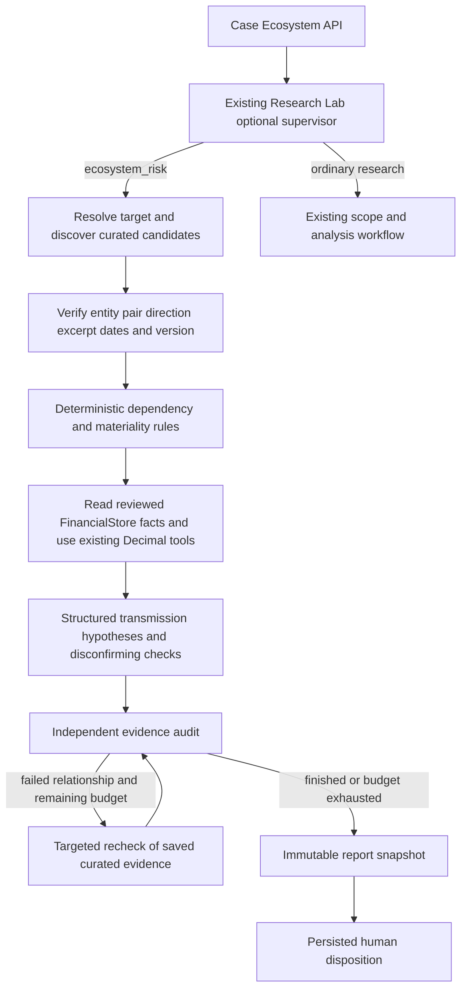

# Corporate Ecosystem Risk MVP

Optional Research Lab investigation for a single target, at most five direct counterparties and one displayed hop. This is an evidence-auditable scenario workflow, not live monitoring, financial advice, loss prediction or trade execution.

## Start the demo

From `Veritas/backend`:

```sh
VERITAS_ECOSYSTEM_DEMO=1 uv run python main.py
```

From `Veritas/frontend/my-app`:

```sh
npm run dev
```

Open Research Lab, create or open a **Microsoft Corporation / MSFT** case, then choose **Ecosystem Risk → Load historical scenario demo**. No document upload, external provider, API key or new dependency is required for this curated demo. Demo loading is server-gated and disabled by default; `.env.ecosystem.example` lists the public configuration. Existing `.env` values were not changed.

The demo explicitly uses **30 July 2025**, the publication date of the FY2025 filing. Normal curated investigations use the date selected in the form. Selecting a much later date correctly flags stale evidence and terminates after at most two saved-source rechecks.

For isolated demo storage, set `VERITAS_RESEARCH_DIR` to a new absolute directory before startup. The app is a single-process local MVP; run one backend worker. All existing Research Lab data stays in its configured directory. The feature adds schema version 6 and `ecosystem_runs`, `ecosystem_objects`, `ecosystem_events`, `ecosystem_reviews`, `ecosystem_scenarios` tables. Migrations run idempotently; no destructive migration or database replacement is performed.

## Architecture



No LLM or network tool is enabled at runtime. The reusable tools are `FinancialStore`, `validate_excerpt`, `normalized_value`, `current_ratio`, `debt_to_equity`, `net_profit_margin`, `ResearchStore` connections and the existing LangGraph supervisor/lifespan. FinancialStore inputs are read-only, confirmed, temporally eligible and source-available. Entity, currency, full period dates and accounting basis must agree before calculation. Conflicting alternatives or missing inputs produce unknowns, not false contradictions.

Relationship annotations in the fixture are curated application-owned extracted data. Words in source text cannot grant tool access, select a supervisor branch, raise limits, verify an edge, or approve a report. Text is displayed escaped by React. URLs come from curated or validated case metadata; the inspector permits HTTP(S) only.

Corporate affiliation in Exhibit 21 does not establish direct legal shareholding, guarantees, cash pooling or material financial dependence. The graph is one displayed hop, not proof of a complete direct legal ownership chain. Missing dependency percentages are retained as unknown even where qualitative criticality supports a hypothetical materiality classification.

## Expected demonstration

- Microsoft → LinkedIn: documented subsidiary affiliation, verified against the dated Exhibit 21 excerpt. Counterparty distress and financial transmission are unknown.
- Northstar Silicon (Demo) → Microsoft: fictional critical sole-source supplier; hypothetical HIGH distress / HIGH dependency / ELEVATED scenario exposure. No confirmed real-world alert.
- Orchard Components (Demo) → Microsoft: fictional distressed, noncritical, replaceable supplier with an adequate assumed inventory buffer; HIGH distress / LOW exposure / no target alarm.
- Meridian Logistics (Demo) → Microsoft: fictional partner with missing concentration, alternatives and financial evidence; UNKNOWN exposure/impact.

Inspect each path's event → dependency → mechanism → consequence → mitigants, source age at as-of, version, exact saved excerpt and SHA-256. Financial outputs preserve entity, period, currency, units, basis, input IDs and calculation provenance. Source hashes fingerprint the saved excerpt, not a complete remote filing.

Review is independent of machine support: APPROVE, REJECT and REQUEST_CHANGES append audit records without altering evidence verdicts. Approval requires explicit limitation acknowledgement and a current source snapshot. Removed/changed reviewed facts block approval; later scenarios reopen the report for review. Reviewer labels are not authenticated users.

## Scenario calculation

`revenue_at_risk = affected_revenue × disruption_severity × unmitigated_fraction`, using Decimal arithmetic.

A calculation requires an eligible official disclosed `affected_revenue` input linked to the verified dependency, full provenance and user-entered fractions from 0 to 1 with an assumption note. The shipped Microsoft fixture contains no such disclosure. Its scenario evaluator therefore saves an **unavailable** result; it does not substitute total Microsoft revenue or invent exposure shares. The numeric formula is exercised against an isolated acceptance-test disclosure. Results, when supported, are labeled assumption-based revenue at risk, never predicted losses.

## API

All routes are case-scoped under `/research/cases/{case_id}/ecosystem` (same-origin frontend proxy `/backend`).

- `GET /config`: mode availability and fixed limits.
- `GET /investigations`: last 50 saved runs.
- `POST /investigations`: `target`, `as_of_date`, `max_depth=1`, `max_counterparties<=5`, `retry_budget<=2`.
- `POST /demo/load`: same input, fixture mode only when explicitly enabled.
- `GET /investigations/{run_id}`: snapshot, findings, real saved stage events and review history.
- `GET /investigations/{run_id}/events?after=0`: SSE replay/progress with terminal event; UI uses polling with visible refresh errors.
- `POST /investigations/{run_id}/review`: `expected_revision`, `decision`, `reviewer_label`, `reviewer_notes`, `acknowledge_limitations`.
- `POST /investigations/{run_id}/scenarios`: relationship ID, severity, unmitigated fraction and assumption notes. Return the updated report and saved result.

At most two concurrent runs, a 30-second execution timeout, two targeted relationship retries, 1,000 inspected reviewed financial facts and 250,000 case-excerpt characters. POST bodies are capped at 64 KiB before JSON parsing. On restart/shutdown unfinished runs become interrupted, never completed. All resource reads/reviews/scenarios enforce case IDs, but there is no authentication or multi-tenant authorization in the host MVP.

## Tests and known limits

```sh
# backend/
.venv/bin/python -m unittest discover -s tests -p 'test_ecosystem.py'
.venv/bin/python -m unittest discover -s tests -p 'test_*.py'
# frontend/my-app/
node --test tests/*.test.cjs
./node_modules/.bin/tsc --noEmit
./node_modules/.bin/eslint src/app/research/components/EcosystemPanel.tsx src/lib/api/ecosystem.ts
```

Offline tests cover the complete supervisor/API path, real application lifespan wiring, all three exposure outcomes, positive and false relationship gates, stale/amended evidence, financial basis mismatches, missing percentages, prompt injection, scenario inputs, exact Decimal results, optimistic review/persistence, case isolation, mode gates, request size, timeout/concurrency limits, restart recovery and SSE replay. Tests use temporary SQLite and never send provider calls, messages or trades.

This is a curated Microsoft/LinkedIn demonstration, not general autonomous corporate/supply-chain discovery. Extending to another target requires new reviewed entity and relationship evidence. The structured transmission template is not an LLM-generated assessment. No background monitoring, authenticated reviewers, durable multi-worker queue, probabilistic risk model, automatic external searching, PDF export or production tenant isolation is included. The existing standalone company report schema is preserved; ecosystem reports are immutable run snapshots with their own auditable export and review records.

Fixture licenses/provenance: `fixtures/README.md`. Repository audit and actual validation results: `docs/ecosystem-risk-implementation.md` at the repository root.

## Additional real-evidence case

Research Lab now includes **Open real-evidence case** for Spirit AeroSystems, Boeing and Airbus. It creates/reopens a separate case dated **28 February 2025**, selects Ecosystem Risk and starts the curated investigation. It works without `VERITAS_ECOSYSTEM_DEMO`. The original Microsoft fixture is unchanged.

Two customer relationships, approximate FY2024 customer concentrations, financial figures, a documented historical strike response and original disclosure links are included. Historical impact is displayed separately from active exposure warnings. An eligible going-concern disclosure overrides the limited ratio screen; nonpositive equity never establishes a LOW health result. The scenario calculator additionally supports a clearly labelled approximate annual customer-revenue sensitivity with full-period/source/direction checks. This never becomes a reported strike loss or forecast. See `docs/spirit-real-evidence-case.md` for definitions and provenance.
